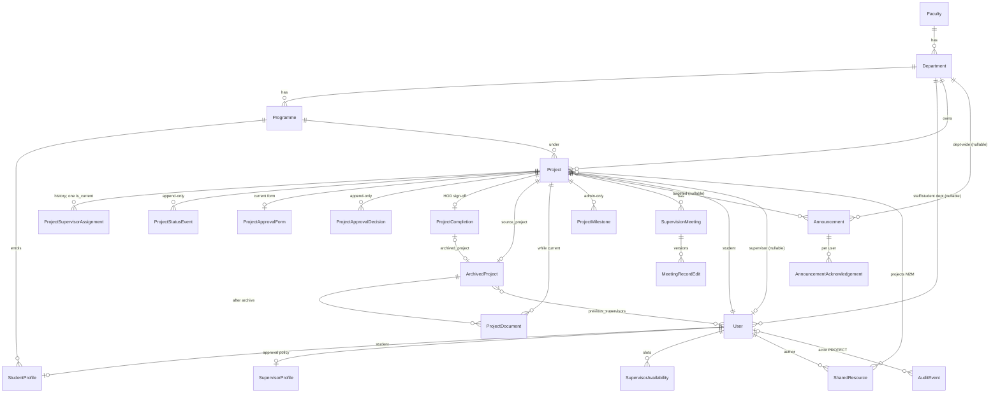

# Review 01 — Inventory, history, workflows, permissions and data model

Branch `repo-review`, based on `slice2-workflow` at `aea2fac`. Review date 2026-10-07.

## How to read this

- **VERIFIED** means I ran the command or read the code at the cited line. **INFERRED** means it is my reasoning from what I read, not something I executed.
- Paths are relative to `projecthub_slice1/` unless they start with the repository root (`/`).
- I did not rely on `README.md`, `PROGRESS.md`, `docs/*` or commit messages for any claim about behaviour. The docs are quoted only where this review compares them with the code.
- Commands used (read-only): `git log --all`, `git for-each-ref`, `git fsck --unreachable --no-reflogs`, `git ls-tree`, `grep`, and a Python script that walks Django's web address resolver (`get_resolver()`), lists `apps.get_models()` and does nothing else.

---

## 1. Inventory

### 1.1 Apps (VERIFIED, `config/settings.py:33-45`)

| App | Purpose (from the code) | Notes |
|---|---|---|
| `apps.academics` | Faculty → Department → Programme tree; one read-only staff page | 3 models, 1 view |
| `apps.accounts` | Custom `User` with `role`, student and supervisor profiles, login, registration, portals, admin tools, audit page view | The audit *page* lives here (`accounts/views.py:288`), the audit *model* in `apps.audit` |
| `apps.projects` | Projects, approval form, workflow, assignment, archive, repository, documents, CSV import | Largest app; `views.py` is 601 lines |
| `apps.supervision` | Meetings, notices, shared resources, availability, approval policy page | Two models never used by any view (see 1.8) |
| `apps.audit` | `AuditEvent` model and `log_event()` service | No web addresses of its own |

### 1.2 Models (VERIFIED by reading each file and by `apps.get_models()`)

| Model | Defined at | Used by views/services? | Flag |
|---|---|---|---|
| `academics.Faculty` | `apps/academics/models.py:15` | yes | |
| `academics.Department` | `apps/academics/models.py:28` | yes | `head_of_department` property (`:42`) is never used |
| `academics.Programme` | `apps/academics/models.py:55` | yes | `is_postgraduate` (`:87`) never used |
| `accounts.User` | `apps/accounts/models.py:22` | yes | `email` is not unique (inherited from `AbstractUser`); the login form resolves it with `.first()` (`accounts/forms.py:23`) |
| `accounts.StudentProfile` | `apps/accounts/models.py:44` | yes | `registration_status` defaults to **APPROVED** (`:64`); only the registration form sets PENDING (`accounts/forms.py:123`). `has_finished_study` (`:75`) is unused |
| `accounts.SupervisorProfile` | `apps/accounts/models.py:82` | yes (approval policy) | `is_accepting_students` (`:114`), `research_interests`, `office`, `specialisation`, `is_active` are never read by any view. The docstring says "shown on the public staff profile", but no such page exists |
| `projects.Project` | `apps/projects/models/project.py:47` | yes | No database rule stops a student having two active projects (see 3.4) |
| `projects.ProjectStatusEvent` | `apps/projects/models/project.py:153` | yes | Append-only in Python |
| `projects.ProjectSupervisorAssignment` | `apps/projects/models/assignment.py:41` | yes | |
| `projects.ProjectMilestone` | `apps/projects/models/milestone.py:8` | read only (`my_project.html`, `guidelines.html`, `approvals` prefetch) | **No view creates or edits milestones**; only the Django admin can |
| `projects.ArchivedProject` | `apps/projects/models/archive.py:19` | yes | |
| `projects.ProjectDocument` | `apps/projects/models/document.py:37` | yes | No file hash, although the plan calls for one (see 4) |
| `projects.ProjectApprovalForm` | `apps/projects/models/approval.py:24` | yes | |
| `projects.ProjectApprovalDecision` | `apps/projects/models/approval.py:118` | yes (written by services; admin view only) | |
| `projects.ProjectCompletion` | `apps/projects/models/approval.py:163` | yes | Defined in `approval.py`, although it is the sign-off record |
| `supervision.SupervisionLogEntry` | `apps/supervision/models/log.py:20` | **no**, admin only (`supervision/admin.py`) | **Unused model** |
| `supervision.SupervisorAvailability` | `apps/supervision/models/meeting.py:33` | yes (`availability` view) | |
| `supervision.MeetingRequest` | `apps/supervision/models/meeting.py:70` | **no**: the only view, `request_meeting`, always raises 403 (`supervision/views.py:348-350`) | **Unused model and form** (`MeetingRequestForm`, `supervision/forms.py:75`), still tested in `supervision/tests.py` |
| `supervision.SupervisionMeeting` | `apps/supervision/models/meeting.py:99` | yes | |
| `supervision.MeetingRecordEdit` | `apps/supervision/models/meeting.py:170` | yes | Not append-only (no guards) |
| `supervision.Announcement` | `apps/supervision/models/notice.py:11` | yes | |
| `supervision.AnnouncementAcknowledgement` | `apps/supervision/models/notice.py:58` | yes | |
| `supervision.SharedResource` | `apps/supervision/models/resource.py:15` | yes | **Two fields for one idea**: `project` FK (`:21`) and `projects` M2M (`:29`). The view always sets `project=None` (`supervision/views.py:274`). `link_href` (`:79`) is unused and would point at `/media/...`, which is not served |
| `audit.AuditEvent` | `apps/audit/models.py:13` | yes | |

### 1.3 web addresses and views (VERIFIED with a script over `get_resolver()`, then by reading each view)

"Guard" is the first permission check on the view. "Object check" is any later check that ties the object to the user.

| Web address | Name | View (file:line) | Guard | Object check |
|---|---|---|---|---|
| `/` | `home` | `accounts/views.py:23` | none (redirects) | — |
| `/login/` | `login` | `accounts/views.py:27` (`ProjectLoginView`) | public | — |
| `/register/` | `register_student` | `accounts/views.py:37` | public | — |
| `/logout/` | `logout` | Django `LogoutView` | POST form (`templates/base.html:53`) | — |
| `/dashboard/` | `dashboard` | `accounts/views.py:56` | `login_required` | Branches on role; **any role that isn't matched gets the admin portal** (`:71`) |
| `/student/portal/` | `student_portal` | `accounts/views.py:74` | `role_required(STUDENT)` | own data |
| `/alumni/portal/` | `alumni_portal` | `accounts/views.py:82` | `role_required(STUDENT)` | own data |
| `/admin-tools/` | `admin_tools` | `accounts/views.py:244` | `role_required(ADMIN)` | — |
| `/admin-tools/audit/` | `audit_log` | `accounts/views.py:288` | `role_required(ADMIN)` | — |
| `/admin-tools/registrations/<id>/review/` | `review_student_registration` | `accounts/views.py:258` | `role_required(ADMIN)` + `require_POST` | only PENDING, non-demo students (`:267-273`) |
| `/academics/` | `academic_structure` | `academics/views.py:9` | staff roles | — |
| `/projects/repository/` | `repository` | `projects/views.py:84` | all 5 roles | — |
| `/projects/running-topics/` | `running_topics` | `projects/views.py:94` | all 5 roles | — |
| `/projects/repository/current/<id>/` | `current_project_detail` | `projects/views.py:101` | all 5 roles | **none**: any signed-in user, including any student, can open any current project by identification number (`:103-109`) |
| `/projects/repository/past/<id>/` | `past_project_detail` | `projects/views.py:123` | all 5 roles | only graduated students' archives (`:130`) |
| `/projects/documents/<id>/download/` | `download_project_document` | `projects/views.py:151` | all 5 roles | see workflow 3.12 |
| `/projects/my-project/` | `my_project` | `projects/views.py:187` | all 5 roles, then student only (`:189`) | own project |
| `/projects/my-project/start/` | `start_project` | `projects/views.py:201` | `role_required(STUDENT)` | own profile must be APPROVED |
| `/projects/my-project/<id>/documents/` | `upload_project_document` | `projects/views.py:585` | `role_required(STUDENT)` | `student=request.user` in the lookup (`:587`) |
| `/projects/workflow/<id>/` | `project_workflow` | `projects/views.py:233` | all 5 roles | role/department/ownership (`:238-248`) |
| `/projects/supervision/` | `supervision` | `projects/views.py:333` | staff roles | POST only for role SUPERVISOR (`:357`, `:370`) |
| `/projects/supervision/assignments/` | `supervisor_assignments` | `projects/views.py:476` | staff roles + `can_assign_supervisors` (`:478`) | own department (`:483-486`) |
| `/projects/approvals/` | `approvals` | `projects/views.py:457` | COORDINATOR, Head of Department, ADMIN | own department unless admin |
| `/projects/guidelines/` | `guidelines` | `projects/views.py:546` | all 5 roles | query scoping |
| `/projects/admin/import-projects/` | `import_projects` | `projects/views.py:569` | `role_required(ADMIN)` | — |
| `/supervision/projects/<id>/meetings/` | `project_meetings` | `supervision/views.py:77` | `login_required` | `_project_access` (`:45-50`) |
| `/supervision/meetings/<id>/` | `meeting_detail` | `supervision/views.py:119` | `login_required` | `_project_access` |
| `/supervision/meetings/<id>/edit/` | `edit_meeting` | `supervision/views.py:151` | `login_required` | `_meeting_editor` (`:53-54`) |
| `/supervision/announcements/` | `announcements` | `supervision/views.py:182` | `login_required` | query scoping; posting only for role SUPERVISOR (`:209`) |
| `/supervision/resources/<id>/download/` | `download_shared_resource` | `supervision/views.py:301` | `login_required` | role checks (`:306-321`) |
| `/supervision/resources/<id>/edit/` | `edit_shared_resource` | `supervision/views.py:283` | `role_required(SUPERVISOR)` | `author=request.user` |
| `/supervision/availability/` | `supervisor_availability` | `supervision/views.py:325` | SUPERVISOR, COORDINATOR, Head of Department | own slots |
| `/supervision/approval-policy/` | `approval_policy` | `supervision/views.py:353` | SUPERVISOR, COORDINATOR, Head of Department | own profile |
| `/supervision/projects/<id>/request-meeting/` | `request_meeting` | `supervision/views.py:348` | `login_required` | **always 403**: dead endpoint |
| `/admin/` | Django admin | `config/urls.py:5` | Django `is_staff` | — |

Every non-public view has `role_required` or `login_required` (VERIFIED). Whether each object-level check is *sufficient* is Pass B's subject. The two clearly open ones are noted above (`current_project_detail`) and in 3.12/3.13.

### 1.4 Templates (VERIFIED by grepping every `templates/**/*.html` name in `apps/**/*.py` and in ``/`` tags)

All 31 templates extend `base.html`. Rendered by a view: `403.html`, `academics/structure.html`, `admin_tools.html`, `audit/log.html`, the 6 `portals/*.html`, the 11 `projects/*.html`, `registration/login.html`, `registration/register.html`, and 7 of the 8 `supervision/*.html`.

**Never rendered:**
- `templates/dashboard.html`: `dashboard` renders `portals/*` instead (`accounts/views.py:56-71`).
- `templates/supervision/request_meeting.html`: its view always raises 403.

### 1.5 Static files (VERIFIED)

`static/css/app.css` (2,052 lines), `static/css/theme.css`, `static/js/navigation.js` are linked from templates. **`static/js/reveal.js` is not referenced by any template.**

### 1.6 Management commands (VERIFIED)

| Command | File | What it does |
|---|---|---|
| `seed_demo` | `apps/accounts/management/commands/seed_demo.py:102` | Refuses when `DEBUG` is False unless `--force` (`:103-104`). Creates demo users with one shared password, default `ChangeMe123!` (`:98`), and projects via `update_or_create`, **setting `stage` directly** (`:140-149`). So seeded projects have no status events or approval forms behind their stage (INFERRED from the code path: no `record_transition` call) |
| `purge_demo` | `apps/accounts/management/commands/purge_demo.py:14` | Deletes rows with `is_demo=True`, children first |

### 1.7 Migrations (VERIFIED, `git ls-files`; `makemigrations --check` reports no changes on this branch)

| App | Migrations |
|---|---|
| academics | `0001_initial`, `0002_department_code_faculty_code_and_more` |
| accounts | `0001_initial` … `0007_supervisorprofile_approval_criteria` (7 files) |
| audit | `0001_initial`, `0002_alter_auditevent_actor` (FK `SET_NULL` → `PROTECT`), `0003_append_only_triggers` |
| projects | `0001_initial` … `0012_projectcompletion_no_gap_confirmed` (12 files). `0005` and `0010` contain data steps |
| supervision | `0001_initial` … `0006_sharedresource_updated_at` (6 files) |

### 1.8 Unused, duplicated, contradictory and leftover items

| Item | Evidence | Status |
|---|---|---|
| `SupervisionLogEntry` model | referenced only in `models/log.py`, `models/__init__.py`, `admin.py` | VERIFIED unused by views |
| `MeetingRequest` model, `MeetingRequestForm`, `request_meeting` view and template | view raises 403 unconditionally (`supervision/views.py:350`) | VERIFIED dead feature |
| `SharedResource.project` FK versus `SharedResource.projects` M2M | `resource.py:21`, `:29`; view forces `project=None` (`views.py:274`) | VERIFIED duplicate concept |
| `SharedResource.link_href` | no references | VERIFIED unused |
| `templates/dashboard.html`, `static/js/reveal.js` | no references | VERIFIED unused |
| `settings.REPOSITORY_PAGE_SIZE`, `PUBLIC_REPOSITORY`, `SITE_NAME` | defined at `config/settings.py:126-132`, read nowhere | VERIFIED unused, so **the repository has no pagination** |
| `services.supervisor_summary`, `supervision_history_for`, `clean_section`, `SECTION_ALL`, `ACTIVE_STAGES` | exported in `__init__.py`, never called | VERIFIED unused |
| `Department.head_of_department`, `Programme.is_postgraduate`, `StudentProfile.has_finished_study`, `ArchivedProject.earlier_supervisors` | no callers | VERIFIED unused |
| `SupervisorProfile.is_accepting_students` | never read; supervisors can add unassigned students regardless (`projects/views.py:360-365`) | VERIFIED unused flag |
| `Project.continuation_link` | no form sets it (`ProjectStartForm`, `forms.py:59-62`); only copied on archive (`lifecycle.py`) | VERIFIED always blank in practice (INFERRED: unless set in admin) |
| `project_workflow` local variable `action` | assigned at `projects/views.py:259`, never used | VERIFIED dead code |
| `docs/database_schema.sql` | 19 tables with names (`project_status_history`, `project_approvals`, `approval_policies`, `meeting_records`, `notices`, `audit_log`…) that match **none** of the 24 Django tables (`projects_projectstatusevent`, `audit_auditevent`…) | VERIFIED. The file says Django is the source of truth (`:6-8`), but anyone drawing the ER diagram from it will draw a different database |
| Approval policy stored on `SupervisorProfile`, not in a separate policy table | `accounts/models.py:95-105` Versus `docs/implementation_plan.md` §6 | VERIFIED difference |
| Untracked leftovers in the working copy | `.live_demo_server*.{log,err}`, `.portal_demo*.{log,err}`, `.live_demo.sqlite3`, `db.sqlite3`, `_probe.txt`, `_run_tests.cmd`, two empty files named `baze_projecthub`, `.test-tmp/` with 3 empty temp folders | VERIFIED present, untracked, not in git |

---

## 2. History

### 2.1 Timeline (VERIFIED, `git log --all --reverse --shortstat`)

| Date (+0100) | Commit | Author field | Co-authored-by trailer | What changed |
|---|---|---|---|---|
| 2026-10-05 09:45 | `3462813` | AjStyles20 \<ajsolomon62@gmail.com\> | **Copilot** \<223556219+Copilot@users.noreply.github.com\> | "Slice 1": 77 files, +4,639. The only commit on `main` and `origin/main` |
| 2026-10-05 16:15 | `1dfda9c` | AjStyles20 | — | "Agent host session ce4d09cb… baseline checkpoint". Parentless commit with the **same tree** as `3462813` |
| 2026-10-05 16:25 | `c1e2854`, `8af1e87` | AjStyles20 | — | "turn 1 start" / "turn 1": same tree again, so no file changes |
| (no commit date) | tree `d5bcdff` | — | — | Held by `refs/codex/turn-diffs/…`: a snapshot of the working tree that already contains `_probe.txt` and `_run_tests.cmd` |
| 2026-10-07 08:17 | `2af75ea` | AjStyles20 | Claude Opus 5.5 | Snapshot of everything uncommitted: 100 files, +7,268/−688 (audit, supervision, models/services split, portals, migrations up to projects `0009`) |
| 2026-10-07 12:20 – 13:13 | `17de39a` … `aea2fac` (8 commits) | AjStyles20 | Claude Opus 5.5 | Slice 2 fixes from this session: time zone, `is_current`, status event guards, decision history, gap check, audit triggers, audit FK tests, coordinator fix |

Refs (VERIFIED, `git for-each-ref`): `refs/heads/{main,slice2-workflow,repo-review}`, `refs/remotes/origin/{main,slice2-workflow}`, `refs/agents/ce4d09cb…/checkpoints/turn/{0,1}`, `refs/codex/turn-diffs/…`.

`git fsck --unreachable --no-reflogs` (VERIFIED) lists unreachable trees and blobs. Their contents are intermediate working-tree states: one tree has projects migrations only up to `0006`, another up to `0008`, and they include the demo server log files.

### 2.2 What git can and cannot tell you about who wrote what

- **VERIFIED:** every commit's author field is your GitHub identity. Git records whoever ran `git commit`, not who typed the code.
- **VERIFIED:** the trailers name Copilot on `3462813` and Claude Opus 5.5 on `2af75ea` onward. A trailer is free text. It shows which tool the committer chose to credit, not who wrote each line.
- **VERIFIED:** the `refs/agents/…` checkpoints and `refs/codex/…` turn-diff ref were left by two other agent tools working in this folder. The first is an unnamed "Agent host"; the second's ref name says "codex".
- **INFERRED:** the work in `2af75ea` (the supervision app, the models/services split, portals, migrations `0006`–`0009`) was written between 5 and 7 October, outside any commit, probably by those agent sessions, because the Codex snapshot and the unreachable trees capture it part-way through. **Git cannot prove which tool wrote any particular line in `2af75ea`.** Everything in that commit should be treated as unreviewed code of unknown origin. That is why this review checks the code, not the commit messages.

### 2.3 The `project_repo` prototype

- **VERIFIED:** `git log --all -- project_repo` returns nothing. No tree in any ref, nor the Codex tree, contains a `project_repo` path. It was never part of this repository's history, so **git cannot recover it**.
- **VERIFIED:** it was not deleted from disk. It exists at `C:\Users\User\Downloads\FYP\project_repo` (243 files, all dated 2026-10-04). It is **not** a git repository (no `.git`).
- **VERIFIED:** it is a different stack. `package.json` names it `app-builder-workspace` (React 19, Vite, TanStack Start, `pg`), `AGENTS.md` begins "You are Grok Build", and there is a `.grok/` folder. `attachments/` holds two "ChatGPT Image Sep 29, 2026" PNGs, `fyp-platform-prototype-v2.html`, and an unrelated `nigeria_public_hospital_monitoring_prototype.html`.
- **How to keep it:** that folder is the only copy. If you want it preserved, copy it somewhere backed up, or `git init` it as a separate repository. Don't add it to this one, because it has its own `node_modules` lockfile and an unrelated prototype.

---

## 3. Workflows as implemented

"Audited" means an `AuditEvent` is written. **`log_event` silently skips any action whose actor or object has `is_demo=True`** (`apps/audit/services.py:6`), so nothing done by or to demo accounts is audited (VERIFIED). Logins, logouts, failed logins, registrations and downloads are never audited: there is no `log_event` call or auth signal handler for them (VERIFIED by grep).

### 3.1 Student registration and approval

1. Anyone opens `/register/` (`accounts/views.py:37`). Signed-in users are redirected.
2. `StudentRegistrationForm` (`accounts/forms.py:36`) checks:
   - the email ends in `@bazeuniversity.edu.ng` (`:72`);
   - the email or username is not already used, case-insensitively (`:74-77`);
   - the student identification number is not taken (`:82`);
   - the passwords match and pass Django's password validators (`:86-103`).
3. `save()` (`:105-125`), in one transaction, creates a `User` with `role=STUDENT`, `is_active=False` and `department` from the programme, plus a `StudentProfile` with `registration_status=PENDING`. **The student picks their own status**, "current" or "Final-year project completed" (`:37-40`, `:122`).
4. An admin opens `/admin-tools/` (`accounts/views.py:244`), which lists non-demo PENDING students, and POSTs approve or reject to `review_student_registration` (`:258`). Approving sets APPROVED and `is_active=True`; rejecting sets REJECTED and `is_active=False` (`:274-282`).
- **Roles:** anyone registers; ADMIN reviews.
- **Audited:** only the review (`account.registration_approve|reject`, `:283`). The registration itself is not.
- **On failure:** form errors. A race on the unique columns is caught as `IntegrityError` and shown as a form error (`:43-46`). There is **no email verification**: whoever controls the form can register any Baze-looking address (VERIFIED: no token or email-sending code exists).

### 3.2 Login

`ProjectLoginView` (`accounts/views.py:27`) uses `ProjectAuthenticationForm` (`accounts/forms.py:14`). The identifier is matched to an email (`User.objects.filter(email__iexact=…).first()`, `:23`), then to a student number (`:25-30`), then used as a username. Django's `ModelBackend` refuses inactive users, so pending and rejected students cannot log in (INFERRED from Django's behaviour; I did not run a login for this pass). With `DEBUG` on, the page shows `demo.amina / ChangeMe123!` (`templates/registration/login.html:18-20`, `accounts/views.py:33`).
- **Audited:** no.
- **On failure:** Django's generic "invalid login" message.

### 3.3 Project start and proposal

1. A student with an APPROVED profile opens `/projects/my-project/start/` (`projects/views.py:201`). If they already have a non-archived project they are redirected to it (`:204-206`).
2. `Project` is created at stage PROPOSED with programme and department from the profile (`:215-222`). A `ProjectStatusEvent` "" → PROPOSED is written (`:223-226`) and audited as `project.created` (`:227`).
3. On `/projects/workflow/<id>/` the student fills `ProjectProposalForm` (`forms.py:46`). `submit_proposal` (`services/approval.py:31`):
   - refuses if the form was already logged, or the stage is not PROPOSED;
   - copies the supervisor's `approval_method`, then `update_or_create`s the single `ProjectApprovalForm`, **resetting any earlier supervisor decision**;
   - keeps `Project.title` in step;
   - audits `project.proposed`.
- **Roles:** the project's own student only.
- **Stored:** `ProjectApprovalForm`. Earlier decisions survive only in `ProjectApprovalDecision` (since `e3e67cc`).
- **On failure:** `ValidationError` is shown as a form error (`projects/views.py:322-324`).
- **Gap:** `start_project` checks "already has a project", then creates one, with no lock and no database constraint (VERIFIED: `Project.Meta` has no constraint, `models/project.py:86-91`). INFERRED: two quick submissions could create two active projects.

### 3.4 Supervisor assignment

Three code paths, all calling `assign_project_supervisor` (`services/assignment.py:20`). That function locks the project, refuses archived projects and staff who are outside the department or inactive, closes the open assignment row and opens a new one, and audits `project.supervisor_assigned`.
1. **Allocation board:** `/projects/supervision/assignments/` (`projects/views.py:476`). Any staff role (SUPERVISOR, COORDINATOR, Head of Department, **ADMIN**) with `can_assign_supervisors=True`, limited to their own department.
2. **Supervisor self-service:** on `/projects/supervision/` (`projects/views.py:333`), role SUPERVISOR can add **any unassigned project in their department** to their own roster (`:360-391`), or remove a student (`:398-414`, `unassign_project_supervisor`, audited `project.supervisor_unassigned`). The student gets a notice. `is_accepting_students` is not checked.
3. **`seed_demo`** (`seed_demo.py:152`).
- **Stored:** `ProjectSupervisorAssignment` rows (one current per project, enforced by the database since `033a75f`) and `Project.supervisor`.

### 3.5 Supervisor decision (approval form)

On the workflow page, a SUPERVISOR, COORDINATOR or Head of Department **who is the assigned supervisor**, at stage PROPOSED, gets `SupervisorDecisionForm` (`projects/views.py:277-289`). `record_supervisor_decision` (`services/approval.py:76`):
1. refuses anyone except the assigned supervisor, stages other than PROPOSED, and an already-signed form;
2. checks the evidence that the supervisor's **current** method requires: literature review and research gap, or working-project text;
3. snapshots the method and criteria, saves the decision, appends a `ProjectApprovalDecision` and audits `project.supervisor_decision`;
4. if the decision is ACCEPTED or ACCEPTED_WITH_CHANGES, calls `record_transition` → SUPERVISOR_ACCEPTED (status event and `project.stage_changed` audit). REJECTED leaves the stage at PROPOSED, and the student must resubmit (3.3).

The plan's per-method **checklist** (`docs/implementation_plan.md` §6) is not implemented. The code checks that the evidence text is non-empty (VERIFIED).

### 3.6 Coordinator approval (logging the form)

At SUPERVISOR_ACCEPTED, any COORDINATOR in the project's department gets `CoordinatorApprovalForm` (`projects/views.py:290-295`). `log_approved_form` (`services/approval.py:122`) checks the department and that the form is signed, records who logged it and when, appends a decision row, audits `project.approval_logged`, then `record_transition` → APPROVED, which sets `approval_date` from `logged_on`. Since `aea2fac` the coordinator no longer has to be the supervisor.

### 3.7 In progress

At APPROVED, the assigned supervisor (any supervising role) gets `StageActionForm` (`projects/views.py:296-301`), then `record_transition` → IN_PROGRESS. **The date entered is ignored** because `STAGE_DATE_FIELD` has no entry for IN_PROGRESS (`services/lifecycle.py:29-33`) (VERIFIED).

### 3.8 Submission

At IN_PROGRESS the student gets `StageActionForm` (`projects/views.py:302-307`). `record_transition` → SUBMITTED refuses unless a document of type REPORT exists (`lifecycle.py:72-73`), and sets `submission_date`. The upload must happen first, at `/projects/my-project/<id>/documents/`.

### 3.9 Defence

At SUBMITTED, any department COORDINATOR (`projects/views.py:308-313`), then `record_transition` → DEFENDED, which sets `defence_date`. There is no "corrections required" loop, although the plan has one (`implementation_plan.md` §5) (VERIFIED: no such stage in `ProjectStage`, `models/project.py:13-22`).

### 3.10 Head of Department sign-off and archive

At DEFENDED, a Head of Department in the department gets `CompletionForm` (`projects/views.py:314-319`). `sign_off_completion` (`lifecycle.py:95`):
1. requires a gap summary or the "no gap" box, and not both (since `b74517f`);
2. checks the stage and the Head of Department's department;
3. writes `ProjectCompletion`, then `_archive_project` (`:145`), which:
   - creates `ArchivedProject`;
   - copies the previous supervisors (ended assignment rows);
   - moves documents from the project to the archive;
   - sets `archived=True` and stage COMPLETED;
   - writes the final status event;
4. updates the student: GRADUATED only if the Head of Department ticks "graduation verified", otherwise FYP_COMPLETED (`:186-198`);
5. audits `project.archived`. **The archived project's `is_demo` decides whether this is skipped.**

**Important gap (VERIFIED):** graduation can only be set at sign-off (`lifecycle.py:190`), in the Django admin, or by `seed_demo`. The past repository and past-project pages show **only graduated students' archives** (`services/repository.py:68`, `projects/views.py:130`, `:156`). A project signed off without "graduation verified" therefore disappears from the repository with no screen to fix it. The Head of Department portal *counts* "graduation checks pending" (`accounts/views.py:212-214`) but offers no action.

### 3.11 Repository search and filters

- **`/projects/repository/`** (past) and **`/projects/running-topics/`** (current) share `_repository_context` (`projects/views.py:30`).
- `read_filters` (`services/repository.py:33`) accepts `q`, `faculty`, `department`, `programme` (digits only), `level` and a 4-digit `year`.
- **Current projects:** non-archived; the year filter uses local-time `updated_at` (`:56-62`).
- **Past projects:** archives of graduated students only; the year filter uses the archive `year` (`:65-75`).
- Search is `icontains` across title, description, keywords, names, department, faculty and programme (plus gap summary for past projects), and across student number **for staff only** (`:113-122`).
- There is no pagination, because `REPOSITORY_PAGE_SIZE` is unused.
- **Roles:** all five.
- **Note (INFERRED, design question):** "the year" of a current project is the year it was last *edited*, not its academic session. That is the behaviour the time zone fix (`17de39a`) preserved.

### 3.12 Document upload and download

- **Upload** (`projects/views.py:585`):
  - The project's own student only, at stages PROPOSED through IN_PROGRESS.
  - Visibility is forced to STAFF_ONLY (`:595`).
  - Extension allow-list and 25 MB limit come from the model validators (`models/document.py:19-25`, `:56-62`).
  - File names are kept under `project_documents/%Y/%m/`, not randomised as the plan says (VERIFIED: no `upload_to` callable).
  - No file hash is stored (VERIFIED).
  - Audited `project.document_uploaded`.
- **Download** (`projects/views.py:151`): the document must belong to a current project, or to a graduated student's archive.
  - Students: a document of a current project needs `project.student == user` **or** `uploaded_by == user` (`:160-166`).
  - STAFF_ONLY needs a staff role or the uploader (`:167-172`).
  - **Staff of any department can download any current project's documents** (VERIFIED: no department check). Whether that is intended is for Pass B.
  - Not audited.
  - **A missing file on disk is not handled** (`document.file.open` at `:174`). INFERRED: it raises a server error. Pass B will check this.

### 3.13 Meetings, notices, resources (supervision app)

- **Meetings:**
  - Scheduled by the assigned supervisor (`supervision/views.py:77`), with a clash check over that supervisor's scheduled meetings. Visible to the student and to **any SUPERVISOR, COORDINATOR or Head of the project's department** (`_project_access`, `:45-50`), including the discussion notes.
  - Edits create a `MeetingRecordEdit` and reset both confirmations (`:57-74`).
  - The student confirms or disputes, and the supervisor confirms (`:126-147`).
- **Notices:**
  - Only role **SUPERVISOR** can post (`:209`). A coordinator or Head of Department who supervises cannot.
  - Opening the notices page **creates an acknowledgement row with `seen_at` for every visible notice** (`:201-207`). For an admin that is every notice in the system.
- **Shared resources:** the form offers "Send to supervisees" (`supervision/forms.py:45-49`), but the save **always sets `department = author.department` and `project=None`** (`views.py:274-275`). Download access for students includes "`project_id is None` and same department" (`:313-315`), and so does the guidelines list (`projects/views.py:556`). So **every current student in the department can see and download every resource, whoever it was "sent to"** (VERIFIED by reading. INFERRED as unintended, because the form's help text says "Only your assigned students are listed").
- **Availability:** supervisors publish weekly slots and students are notified. Students **cannot book** (dead `request_meeting`).
- **Approval policy page:** edits `SupervisorProfile.approval_method` and `approval_criteria`, and notifies the supervisor's students.

### 3.14 Project stages (VERIFIED from `TRANSITION_ROLES`, `lifecycle.py:35-41`, and `sign_off_completion`)

```mermaid
stateDiagram-v2
    [*] --> Proposed: student starts project (start_project)
    Proposed --> Proposed: supervisor declines -> student revises and resubmits
    Proposed --> SupervisorAccepted: assigned supervisor accepts (record_supervisor_decision)
    SupervisorAccepted --> Approved: department coordinator logs form (log_approved_form)
    Approved --> InProgress: assigned supervisor marks started
    InProgress --> Submitted: student, needs a REPORT document
    Submitted --> Defended: department coordinator records defence
    Defended --> Completed: department HOD signs off; needs gap or "no gap"
    Completed --> [*]: ArchivedProject created, project.archived = True
```

There are no backward transitions (no corrections loop, no withdrawal) and no cancellation (VERIFIED: `TRANSITION_ROLES` only goes forward).

---

## 4. Roles and permissions: the code compared with `docs/implementation_plan.md` §4

| Capability | Plan | Code (VERIFIED at cited lines) | Difference |
|---|---|---|---|
| Browse repository | all 5 | all 5 (`REPOSITORY_ROLES`, `projects/views.py:27`) | Same. But past work appears only once the student is GRADUATED, which the plan doesn't say |
| See student identification number | staff ✔, student ✘ | staff roles in search and project detail (`repository.py:119`, `project_detail.html:63-64`, `supervision.html:30`); admin tools list | Same |
| See contact | consent only, admin ✔ | consent only for **everyone, admin included** (`project_detail.html:77-80`) | Admin can't see unconsented contact. Stricter than the plan |
| Propose project | student (own) | student (own) (`views.py:201`, `:262`) | Same |
| Accept idea / mark started | supervisor (own students) | **any of SUPERVISOR, COORDINATOR, Head of Department who is the assigned supervisor** (`views.py:277`, `:296`; `lifecycle.py:36-38`) | Broader: coordinators and Heads of Department can supervise |
| Record approval / defence | coordinator | coordinator in the project's department (`views.py:290`, `:308`; `approval.py:126`; `lifecycle.py:37`, `:40`) | Same (since `aea2fac`) |
| Assign or change supervisor | coordinator | **any staff role incl. ADMIN with `can_assign_supervisors`** (`views.py:476-479`), **plus any SUPERVISOR self-assigning unassigned students** (`views.py:360-391`) | Broader in two ways |
| Sign off and archive | Head of Department only | Head of Department in the department (`lifecycle.py` sign-off checks) | Same |
| Submit final project | student (own) | student (own), REPORT required | Same, with an extra rule |
| Log meeting | supervisor | assigned supervisor of any supervising role (`supervision/views.py:82`, `:53-54`) | Broader |
| Post notice | supervisor | **role SUPERVISOR only** (`supervision/views.py:209`) | Narrower than "log meeting": a coordinator or Head of Department who supervises can log meetings but cannot post notices |
| View meeting records | own | student (own) **and any SUPERVISOR, COORDINATOR or Head of Department in the department** (`_project_access`) and admin | Broader |
| Edit own entry (versioned) | all 5 | supervisor edits meeting records (versioned). Students can only confirm or dispute and comment. Proposal resubmission overwrites the form, with decision history kept separately | Students can't edit entries |
| View audit log | admin | admin (`accounts/views.py:288`) | Same |
| Demo data / CSV import | admin | CSV import: admin (`views.py:569`). Demo data: command line only | No user interface for demo data |
| Workflow evidence (§5/§7) | status history, approval rows and audit per transition; file hash; corrections loop; database user without UPDATE/DELETE on audit | status events, approval decision rows (supervisor and coordinator steps only) and audit (non-demo); **no file hash; no corrections loop; database privileges not restricted** (`.env` user has ALL on the schema, VERIFIED in this session with `SHOW GRANTS`); triggers present (`audit/migrations/0003`) | Partly implemented |

---

## 5. Data model (ER summary, VERIFIED from the model files)



Key rules held by the database (VERIFIED):
- `ProjectDocument` belongs to exactly one parent (CHECK, `models/document.py:80-88`).
- One current supervisor per project (UNIQUE `(project, is_current)` plus a CHECK, `models/assignment.py`).
- `SharedResource` must have a web address or a file (CHECK, `resource.py:60-65`).
- Department names are unique per faculty, and programmes unique per department, name and degree type.
- One acknowledgement per (notice, user).
- Audit UPDATE and DELETE are blocked by triggers (`audit/migrations/0003`).

**Not held by the database:**
- one active project per student;
- the stage order (any code can set `stage`; `seed_demo` does);
- `ArchivedProject` uniqueness, which the CSV import checks in Python only (`imports.py`).

`MeetingRequest` and `SupervisionLogEntry` (with their FKs to `Project`, `User` and `SupervisorAvailability`) are left off the diagram because nothing uses them.
